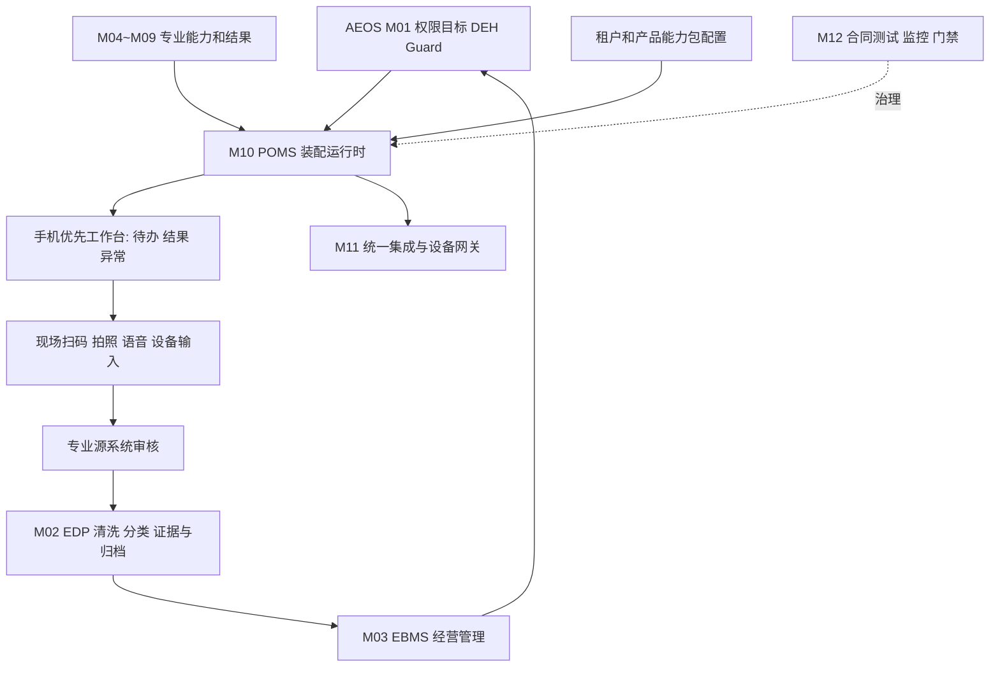

# AEOS-POMS 岗位自适应个人微操作系统总体方案 V2.2
> 日期：2026-10-10 | 模块：M10 | 上位框架：AEOS V7.2 | 状态：PROPOSED / G0待审批 | 迭代基线：POMS V2.0 + V2.1 对标整改与契约草案。
>
> 本文件是完整实施设计候选稿；不宣称代码已开发、业务验收通过、正式总纲原件已恢复或 P0 已签批。所有受控结论以 docs/BASELINE_MANIFEST.md 与 Ledger 为准。

## 1. 设计目标与成功判据
将 AEOS M10 建成统一的末端岗位执行入口，不是独立 ERP/第二个 Kernel；自动按人员岗位、职责、授权、业务对象和产品版本拼装功能；移动端优先，极简操作；业务采集统一可追溯；以公专分离让恒剑灯具与贞观定时器仅切换企业配置及专业能力包，原则上不改公共代码。
- 业务指标：减少重复录入、任务操作步骤、异常平均处置时间；由恒剑试点基线与试运行实测确认。
- 技术指标：无跨域数据库写入、功能装配与执行权限一致、证据可追溯、事件幂等、能力包可回滚、跨租户隔离。
- 治理指标：G0~G6 受控，done 不等于 verified；代码合并不等于业务完成。

## 2. 非目标 / 边界
POMS 不拥有 Person/Org/Position 主数据，不自建权限审批引擎，不自建专业订单/财务/质量数据表，不实现 DEH 第二状态机，不自行存储长期 Evidence 主档，不使 LLM 直接操作 PLC/关键设备，不引入 M13 等新一级模块。
所有 M01/M02/M04~M09/M11/M12 归属严格参考 architecture/SYSTEM_REGISTRY_V1.md 与 DATA_OWNERSHIP_MATRIX_V1.md，必须以 Owner 签批后生效。

## 3. 分层体系与公专分离
### 3.1 共享公共层
M01 Identity/Org/Position/Goal/Policy/Guard/DEH/Skill Registry；M02 Object/Event/Evidence/Provenance/Data Quality；M11 API Gateway/Connector/Device Gateway；M12 CI/Observability/Gate。
M10 自有轻量公共组件：工作台 UI renderer、任务/结果/异常卡、移动采集控件、功能注册读取与装配运行时、同步队列、前端状态管理。严禁再次复制 M01/M02 的权威事实。
### 3.2 标准业务能力
来自 M04~M09 自治中心的 Domain Facade 描述及动作链接（采购、仓储、生产、销售、品质、财经、研发），专业规则和正式数据仍归各自治中心。
### 3.3 企业差异配置
企业代码 tenant_id、组织/岗位映射、岗位授权和职责隔离、审批阈值、数据映射、系统连接器参数、通知语言、设备资源，不是产品插件。
### 3.4 产品专用能力包
按产品 family/model/process_revision 绑定：专用参数、工艺、检验判据、UI Schema、专业 Skills 和安全设备 adapter。仅专业差异允许新增专用代码；通用逻辑优先配置实现。多产品包可并行在同一企业运行。

## 4. 总架构

注意逻辑图不表示绕过 Domain API 直接调用其他系统数据库。

## 5. 角色动态装配规范
装配输入：tenant_id、actor_id、positions、grants、segregation_of_duties、action/object_ref、product family/model/process revision、device capabilities、context_revision。
装配步骤：认证 -> 获取岗位与授权 -> 匹配已批准标准/产品能力 -> 校验依赖/版本 -> 过滤风险能力 -> 返回签名 UI manifest -> 执行前再鉴权与 Guard 检查。
装配输出：manifest_id/version、capabilities、todo feeds、menu slots、widgets、permissions snapshot、expiry、trace_id。
兼岗界面合并不代表权限升级；跨租户默认拒绝；岗位撤销与授权过期后强制刷新；不可仅依靠前端隐藏控件做授权。
配置热更新需审计，失败采用上一个已批准版本，危险动作 fail closed。

## 6. 个人界面与三化融合
- 首页只呈现：未来待办、过去结果、重要异常；不做传统 ERP 多级菜单。
- 最末端输入：底部固定“扫码/拍照/语音/异常”，只在设备支持且已授权时呈现。
- 一条任务尽量三步内完成常用操作；复杂或安全流程不为凑三步而省略确认。
- 手机优先，自适应平板/桌面；电脑端处理复杂配置和大规模分析。
- 暂按标准化、自动化、智能化建立验收纬度，并以精益化约束不必要重复输入；“三化”法定项目定义需正式总纲 Owner 确认。
- 标准化：统一 UI/数据/流程/权限/证据；自动化：取数、预填、任务流转、校验；智能化：受控 Agent+Skill 的异常分析、推荐和验证；精益：关注操作时长、重复录入率、等待与返工。

## 7. 移动端能力（P0/P1/P2）
P0：首页、任务、异常、结果、扫码、拍照及证据绑定、语音转写+人工确认、最小离线安全队列、幂等同步、待审状态提示、消息提醒、弱网失败处理；响应式 Web/PWA 优先验证。
P1：复杂语音辅助、多设备 NFC/BLE 接入、离线冲突处理优化、现场智能推荐；评估原生容器对持续扫码和后台通知支持。
P2：经 M11 网关与业务 Guard 审批的设备互动，不通过 LLM 直接下发安全相关指令。
不承诺所有移动浏览器均能支持后台推送/蓝牙/NFC；需按设备和部署环境进行能力矩阵及回退设计。

## 8. 末端采集与 EDP 审核
输入统一 envelope：tenant_id, actor_id, role_context, source_system, device_id, object_ref, action_id?(可为空), captured_at, capture_type, evidence_ref, schema_version, correlation_id, trace_id, idempotency_key, sync_state。
源系统拥有原始专业事实；M02 拥有企业统一 Event/Evidence/Audit；M10 仅缓存待同步数据并显示审核状态。
标准处理：现场产生 -> 本专业业务系统人机审核 -> EDP 清洗/标准化/去重/多维分类/置信度 -> 管理系统权限下人机复核 -> 最终归档。风险级别可决定低风险自动审核和高风险强制人工签批，规则必须经 Owner 授权。
原始数据和修订记录不可静默覆盖；未归档数据展示 pending 状态；网络重试防重复；禁跨企业数据混合。

## 9. 任务、决策、结果、证据
完全引用 contracts/DEH_CONTRACT_V1.md 和 contracts/CONTRACT_PACK_V1.md：
Fact -> Event -> DecisionCase -> Decision -> Action -> Result -> Verify -> Evidence。
业务场景不强制每条操作有 Decision/Meeting；非会议来源可以触发 Action；保持稳定 object_ref。
Action done = 执行者声明，Result submitted != verified；验证由授权 Validator/规则完成且 Evidence 可反查 source/version/checksum。
标准事件必须传 correlation_id/causation_id/idempotency_key；任务创建/结果提交支持去重。

## 10. 专用包结构和生命周期
参考 contracts/POMS_CAPABILITY_PACKAGE_CONTRACT_V1.md：
```
pack/
  manifest.yaml
  schemas/product.json
  schemas/ui.json
  process/
  quality/
  skills/
  adapters/
  evidence/
  tests/
```
注册 -> 安全扫描及 Schema 测试 -> Domain Owner 审核 -> 发布 -> 按租户/型号/版本激活 -> 可观测 -> 灰度升级/独立回滚。
同企业允许灯具、定时器同时运行；历史订单锁定当时的 process_revision 及 pack_version，避免配置变化污染历史记录；数据库 schema 迁移由专业 Owner 管理。

## 11. 恒剑灯具 -> 贞观定时器迁移演练
阶段 A：采集两企业业务事实、人员组织与系统接口，确定 T0、产品规格、检验项目和实际设备，不用演示数据代替生产数据。
阶段 B：恒剑灯具复用扫码、任务、检验、证据公共组件，加载 lighting pack（光效/色温/功耗/散热等以真实产品标准为准）。
阶段 C：贞观启用独立 tenant/config 与 timer pack（时间精度、触发逻辑、继电器/控制测试等按真实型号为准）。
阶段 D：同平台并行执行样本任务：不同产品正确装配字段和 Skill；跨租户不可见；提交幂等；审批分离；检验原始证据可追溯；断网恢复不丢数据；旧版本可回滚。
硬门槛：迁移期间 M01/M02/M10 公共代码无产品特异 diff；若必须修改公共代码，先 ADR 归类为通用缺陷或拒绝该设计，不以复制分叉绕过。
阶段 E：G6 商业复制另需价值 T0/Value、实施成本、企业满意与经营改进，不由技术演练代替。

## 12. 首期 MVP 独立执行方案
**试点**：恒剑品质首件检验（M08 Owner）；**边界**：1 企业、1 质量岗位模板、1 产品系列、1 检验流程、1 手机端。
前置：G0 系统边界与契约签批，确认 M01 身份接口、M08 检验数据接口、M02 Evidence 入口；未准备好采用 mock adapter 测模拟版，不伪称真实闭环。
工作包：
WP01 岗位与权限映射：用一个测试员工/兼岗/撤权样本，验证授权与职责分离。
WP02 任务视图：DEH Action 列表、完成声明、Result 提交、待验证/已通过状态。
WP03 末端采集：扫码对象识别、检验参数输入、拍照上传和语音确认，附原始时间/来源/证据。
WP04 专用包：lighting 检验 manifest、UI JSON Schema、规则引用与版本；不把检验算法写入 M10。
WP05 数据流程：M08 源审核、M02 清洗归档、管理复核和 evidence 关联。
WP06 非功能：PWA 适配、断网幂等、数据隔离、日志、失败提示。
WP07 验收：一条真实检验任务从 Fact/Action -> Result -> Verified -> Evidence 与 EBMS 结果可查。
首次开发只保留关键闭环，其余 NFC/IoT/自进化不作为 MVP 必须交付。

## 13. 接口最小清单（拟议路径，最终以 M01/M02/M08 核准 OpenAPI 为准）
GET /poms/v1/me/manifest
GET /poms/v1/me/actions
POST /poms/v1/captures
POST /poms/v1/actions/{id}/complete
POST /poms/v1/results
GET /poms/v1/evidence/{id}
GET /poms/v1/capabilities
POST /poms/v1/sync
POMS BFF 仅代理/编排，内部通过已授权 Domain API；对旧接口做 anti-corruption mapping，正式请求必须携带 tenant_id、trace_id、correlation_id、幂等键等规定字段。

## 14. 验收矩阵
| ID | 场景 | 通过条件 | Gate |
|---|---|---|---|
| AT01 | 新岗位上岗 | 无代码改动，功能依授权装配 | G0/G2 |
| AT02 | 兼岗/撤权 | 合并展示、敏感写入拒绝、撤权即时生效 | G2 |
| AT03 | 同企业多产品 | 灯具和定时器正确加载不同 pack/version | G2 |
| AT04 | 跨企业复制 | 不改变公共代码，不跨租户读写 | G6 |
| AT05 | 完成状态 | done 与 Result verified 严格分离 | G3 |
| AT06 | 原始数据 | 采集/审核/清洗/归档/证据完整追溯 | G3 |
| AT07 | 网络重试 | 同一 idempotency_key 不重复产生记录 | G2 |
| AT08 | 设备风险 | LLM 不能直接发 PLC 指令 | G5 |
| AT09 | 包发布 | 不兼容被阻断，老包能回滚 | G2/G5 |
| AT10 | UI效率 | 现场试用，记录步骤与操作耗时并与基线比对 | G3/G4 |
| AT11 | 价值复制 | T0/Value/成本/满意和真实结果有证据 | G6 |
KPI 候选：关键采集追踪覆盖率 100%；重要结果证据完整率 100%；常用任务交互 P95 <=2秒（同机型网络条件）；高频操作目标 3 步以内。以上为候选目标，需实测与 Owner 批准。

## 15. 风险与回滚
R1 基线原件缺失：G0 不得声称签批完成；参考 docs/BASELINE_REMEDIATION_PLAN_20261010.md。
R2 专业规则误搬入 M10：Contract lint + Owner code review；拒绝合并。
R3 未验证变为已完成：服务端状态校验与审计。
R4 离线重复、跨租户泄露：幂等、租户强制过滤和权限负测。
R5 设备指令安全：M11 Guard 和 PLC 联锁。
R6 产品包变更影响历史业务：版本钉住、双版本演练、可回滚。

## 16. 分阶段和交付责任
- L0 模拟：UI 装配与产品切换；G0 设计审查，不当作生产系统。
- L1 MVP：WP01~WP07；满足 G1、G2、G3 适用门禁。
- L2 推广：增加仓储/报工、移动稳定性、管理视图 G4。
- L3 迁移：跨企业多租户技术演练并走 G6 价值与复制验收。
- L4 自治：Skill/Guard/回滚与 G5 评测。
Owner：M10 技术 Lead 负责装配与 UI，M01 负责身份授权/DEH，M02 负责数据证据，M08 负责首批检验事实，M11 负责外设，M12 测试和 Gate，M00 协调；人名待正式填入 Ledger。

## 17. 下一步审批与回写
本稿 G0 审批需：Architecture Board 确认 M10 范围，业务 Owner 确认试点、三化释义、数据审核分级，M01/M02/M08 签署 API/Schema，M12 确认测试矩阵。审批后形成 V2.2 EFFECTIVE 文档，修改 System Registry/Contract Pack 必须另走 ADR，不直接篡改已冻结规则。
相关依据：architecture/SYSTEM_REGISTRY_V1.md; architecture/DATA_OWNERSHIP_MATRIX_V1.md; architecture/DEH_BOUNDARY_V1.md; contracts/CONTRACT_PACK_V1.md; contracts/DEH_CONTRACT_V1.md; contracts/POMS_CAPABILITY_PACKAGE_CONTRACT_V1.md; contracts/POMS_MOBILE_INPUT_CONTRACT_V1.md; docs/P0/POMS_V2.1_DIFFERENCE_REMEDIATION_MATRIX.md。
